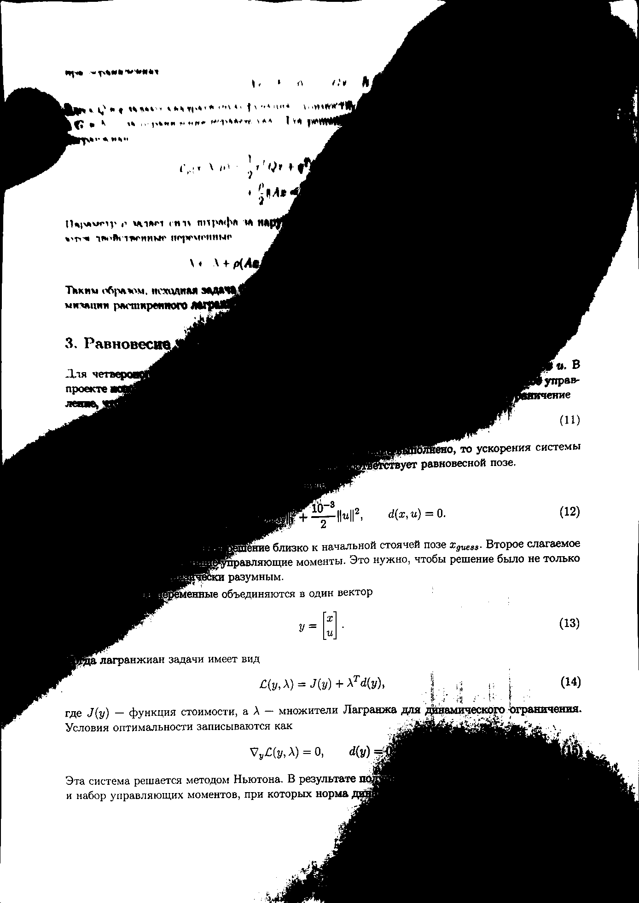
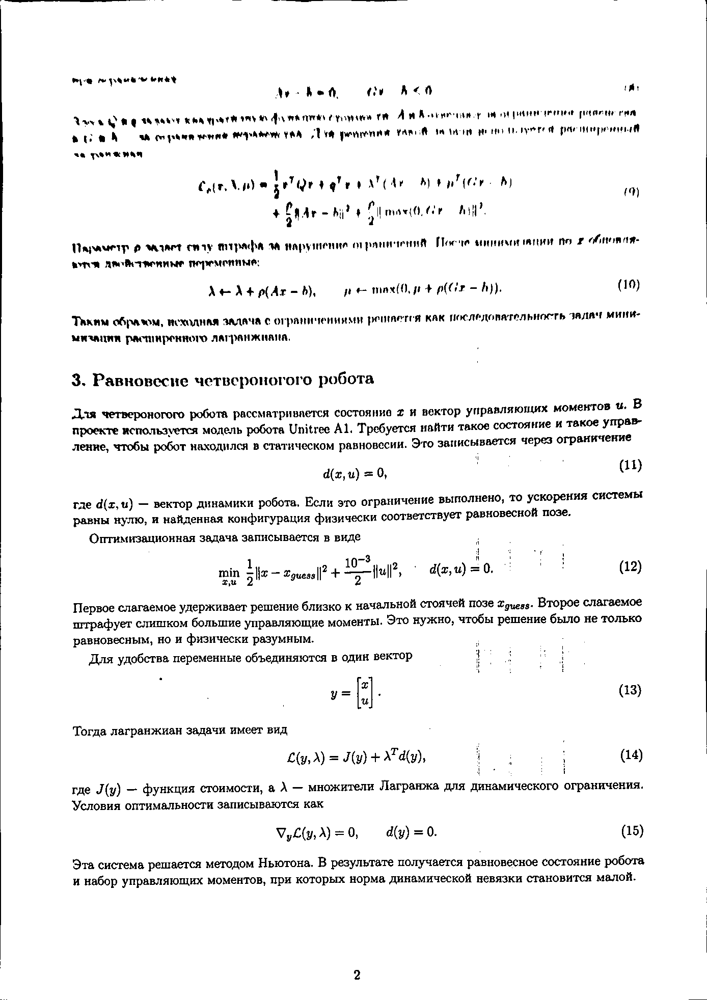
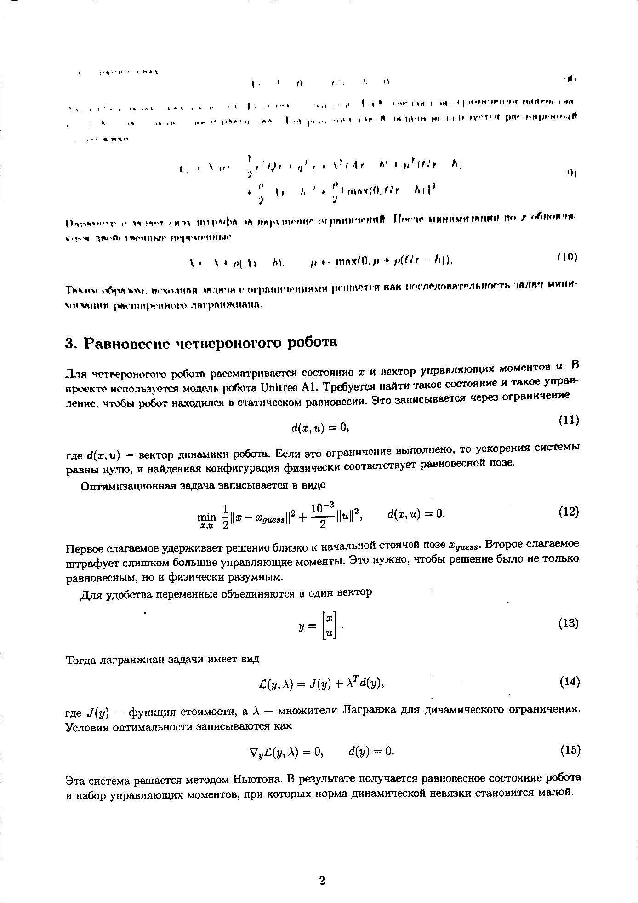

# ДЗ 2 «Сканер документов» — отчёт

**Автор:** Егор Горошко **Группа:** MFAI-01 **Дата сдачи:** 02.11.2026

## 1. Числа

Кадры: `data/01.jpg`–`18.jpg`, разметка: `data/corners.json`. Размер поиска — 640 px, seed=0. Команды для всех измерений — в §5.

### 1.1. Шум

`noise data/06.jpg`, `noise data/07.jpg`, `noise data/12.jpg`:

| Кадр | Свет | σ шума | σ фильтра |
| --- | --- | --- | --- |
| 06.jpg | День | 0.99 | 1.0 |
| 07.jpg | Лампа сбоку | 0.99 | 1.0 |
| 12.jpg | Полумрак | 0.74 | 1.0 |

`noise data/01.jpg --add-sigma 5`, затем 10 и 25:

| Добавлено σ | Оценка σ | σ фильтра | Остаток измеренный | Остаток по формуле |
| --- | --- | --- | --- | --- |
| 5 | 5.44 | 1.53 | 0.92 | 0.92 |
| 10 | 10.38 | 2.93 | 0.97 | 0.96 |
| 25 | 24.46 | 3.0 | 2.38 | 2.35 |

### 1.2. Края

`edges data/NN.jpg` с ключами из таблицы:

| Кадр | Ключи | Медиана | lo / hi | Краёв, % | Отрезков Хафа |
| --- | --- | --- | --- | --- | --- |
| 03.jpg | по умолчанию | 139.0 | 93 / 184 | 0.86 | 25 |
| 03.jpg | --close 0 | 136.0 | 91 / 180 | 0.95 | 31 |
| 03.jpg | --canny 50,150 | 139.0 | 50 / 150 | 0.95 | 23 |
| 10.jpg | по умолчанию | 110.0 | 73 / 146 | 1.36 | 15 |
| 10.jpg | --close 0 | 105.0 | 70 / 139 | 3.24 | 73 |

### 1.3. Набор: IoU и время

`eval data --ann data/corners.json --seeds 20`. Успех: IoU ≥ 0.9; на негативных кадрах — отказ. Время указано в мс. Для Хафа проверены seed=0–19.

| Кадр | Содержание | Контуры IoU | Хаф IoU | Хаф: успехов /20 | Auto IoU / путь | мс: контуры / Хаф / auto |
| --- | --- | --- | --- | --- | --- | --- |
| 01.jpg | Тёмный стол, почти сверху | 0.996 | 0.994 | 20 | 0.996 / contour | 22.2 / 70.8 / 9.9 |
| 02.jpg | Тёмный стол, наклон | 0.996 | 0.996 | 20 | 0.996 / contour | 11.3 / 54.0 / 11.1 |
| 03.jpg | Тёмный стол, сильная тень | 0.994 | 0.927 | 20 | 0.994 / contour | 11.3 / 56.7 / 9.9 |
| 04.jpg | Тёмный стол, поворот листа | 0.981 | 0.0 | 0 | 0.981 / contour | 10.8 / 56.8 / 12.1 |
| 05.jpg | Палец на нижнем углу | 0.0 | 0.992 | 20 | 0.992 / hough | 8.9 / 57.4 / 53.7 |
| 06.jpg | Светлый стол, ровный свет | 0.0 | 0.0 | 0 | 0.0 / — | 7.7 / 8.7 / 7.8 |
| 07.jpg | Светлый стол, ручка и тень | 0.0 | 0.0 | 0 | 0.0 / — | 7.9 / 39.8 / 37.7 |
| 08.jpg | Светлый стол, слабый свет | 0.0 | 0.0 | 0 | 0.0 / — | 9.1 / 40.8 / 38.7 |
| 09.jpg | Клетчатый фон, почти сверху | 0.0 | 0.994 | 20 | 0.994 / hough | 7.8 / 49.1 / 54.7 |
| 10.jpg | Клетчатый фон, поворот и загиб | 0.0 | 0.963 | 20 | 0.963 / hough | 8.5 / 53.0 / 55.8 |
| 11.jpg | Узорчатый фон, сильная перспектива | 0.983 | 0.993 | 20 | 0.983 / contour | 10.1 / 55.1 / 9.9 |
| 12.jpg | Тёмный стол, слабый свет | 0.991 | 0.992 | 20 | 0.991 / contour | 9.6 / 53.2 / 9.9 |
| 13.jpg | Светлый стол, поворот | 0.0 | 0.0 | 0 | 0.0 / — | 7.1 / 7.2 / 7.6 |
| 14.jpg | Клетчатый фон, ручка на границе | 0.0 | 0.991 | 20 | 0.991 / hough | 7.8 / 56.2 / 51.3 |
| 15.jpg | Светлый стол, боковой свет | 0.0 | 0.0 | 0 | 0.0 / — | 8.4 / 32.1 / 28.1 |
| 16.jpg | Книга, листа нет | найден | найден | 0 | найден / contour | 8.9 / 52.5 / 9.4 |
| 17.jpg | Два угла листа вне кадра | нет | нет | 20 | нет / — | 7.8 / 39.0 / 38.5 |
| 18.jpg | Белый лист на белом фоне | нет | нет | 20 | нет / — | 8.3 / 7.4 / 8.2 |

Сводка: найдено из 15 · средний IoU (с отказами) · отклонено из 3 · среднее время, мс.

| Настройка | Контуры | Хаф | Auto |
| --- | --- | --- | --- |
| Медиана, close=9 | 6/15 · 0.396 · 2/3 · 9.6 | 9/15 · 0.589 · 2/3 · 43.9 | 10/15 · 0.659 · 2/3 · 25.2 |
| Canny 50,150 | 7/15 · 0.518 · 2/3 · 9.3 | 7/15 · 0.451 · 3/3 · 47.9 | 9/15 · 0.649 · 2/3 · 23.4 |
| Медиана, close=0 | 6/15 · 0.429 · 2/3 · 9.9 | 6/15 · 0.392 · 3/3 · 49.9 | 9/15 · 0.628 · 2/3 · 26.6 |

Сверка на `../homeworks/hw2-docscan/sample_data` совпала с числами курса: контуры — 2/4, IoU 0.493; Хаф — 3/4, 0.747; auto — 3/4, 0.742. Негативный кадр отклонён всеми; успехи Хафа на desk/corner/tiles/plain — 20/20/18/0 из 20.

### 1.4. Бинаризация

`binarize` на `text-lamp.png` с эталоном `text-gt.png` и на скане 03:

| Кадр / показатель | Otsu | Adaptive | Flat |
| --- | --- | --- | --- |
| text-lamp: совпадение с эталоном, % | 56.8 | 98.8 | 99.9 |
| Выпрямленный 03: доля чернил, % | 47.39 | 5.26 | 4.30 |

Otsu закрашивает тень; adaptive и flat сохраняют текст. Для 03 измерена доля чёрных пикселей, а не точность: эталона нет.

| Otsu | Adaptive | Flat |
| --- | --- | --- |
|  |  |  |

Сканы 03 и 04: `out/scans/03_scan.jpg`, `out/scans/04_scan.jpg`; размеры 1388 × 1963 и 906 × 1281 px, пропорции A4.

### 1.5. Видео

Intel Core i7-8700K, 3.70 GHz. Вход: `data/input.mp4` — подготовленный ролик с телефона, 720 × 1280 px, 20 FPS, 10 с. Контуры и Хаф измерены без записи, auto — с записью.

| Режим | Кадров | FPS обработки | Кадров с рамкой, % | Медиана detect, мс |
| --- | --- | --- | --- | --- |
| contour | 200 | 123.0 | 36.0 | 5.9 |
| hough | 200 | 18.8 | 47.5 | 49.6 |
| auto | 200 | 23.3 | 51.0 | 47.5 |

Результат: [out/video.mp4](out/video.mp4), 10 с, 8.88 МБ. Auto быстрее 10 FPS; доля обнаружений не равна точности, поскольку часть кадров без листа. Живой запуск с веб-камерой не выполнен.

## 2. Три вопроса

**2.1. Контуры или Хаф?**

На [03](out/edges/03_auto.png) и [04](out/edges/04_auto.png) контуры выигрывают: IoU 0.994 и 0.981 против 0.927 и отказа у Хафа, потому что граница достаточно цельная, а посторонние линии мешают Хафу. На [05](out/edges/05_auto.png) и [14](out/edges/14_auto.png) палец и ручка нарушают контур, но Хаф восстанавливает стороны: IoU 0.992 и 0.991, успех 20/20 на обоих кадрах. Контуры быстрее: в среднем 9.6 мс против 43.9 мс. Оба пути теряют 06, 07, 08, 13, 15 из-за слабой или неполной границы на светлом фоне.

**2.2. Пороги Canny**

Медианные пороги в auto дали 10/15 успешных листов, фиксированные 50/150 — 9/15. На 06 медиана 195 даёт пороги 130/255 и ноль краёв: яркий фон поднимает пороги выше перепада на границе. С 50/150 появляются 0.38% краёв, но полного листа всё ещё нет. Оставлены медианные пороги и закрытие 9: на этом наборе они дали больше успешных кадров.

**2.3. Шум и закрытие текста**

Для дня, лампы и полумрака σ шума равна 0.99, 0.99 и 0.74; σ фильтра во всех трёх случаях — 1.0. На уменьшенных кадрах полумрак не дал большей оценки шума. При добавленных σ=10 и 25 остаток составил 0.97 и 2.38 против расчётных 0.96 и 2.35. Закрытие на 10 уменьшило края с 3.24% до 1.36% и отрезки с 73 до 15; на 03 — с 0.95% до 0.86% и с 31 до 25, убрав мелкие линии текста и фона.

## 3. Негативные кадры и отказ

| Кадр | Ответ всех режимов по умолчанию | Причина |
| --- | --- | --- |
| 16, книга | Ложно найден лист | Светлая прямоугольная обложка проходит проверку формы и яркости. |
| 17, два угла вне кадра | Не найден | Не хватает четырёх сторон листа. |
| 18, белое на белом | Не найден | Слабый контраст границы. |

Отказ на 06: IoU=0, высокие пороги убирают границу листа. Помогли бы более контрастный фон или локальный выбор порогов.

## 4. Настройка

```text
--method auto --canny auto --close 9 --long-side 640
```

## 5. Команды

Запуск из папки решения; пути `../homeworks/hw2-docscan/sample_data` и `../lectures` относятся к материалам курса.

```bash
python -m pytest tests -q
python docscan.py noise data/06.jpg
python docscan.py noise data/07.jpg
python docscan.py noise data/12.jpg
python docscan.py noise data/01.jpg --add-sigma 5
python docscan.py noise data/01.jpg --add-sigma 10
python docscan.py noise data/01.jpg --add-sigma 25
python docscan.py edges data/03.jpg -o out/edges/03_auto.png
python docscan.py edges data/03.jpg --canny 50,150 -o out/edges/03_fixed.png
python docscan.py edges data/03.jpg --close 0 -o out/edges/03_no_close.png
python docscan.py edges data/04.jpg -o out/edges/04_auto.png
python docscan.py edges data/05.jpg -o out/edges/05_auto.png
python docscan.py edges data/06.jpg -o out/edges/06_auto.png
python docscan.py edges data/06.jpg --canny 50,150 -o out/edges/06_fixed.png
python docscan.py edges data/10.jpg -o out/edges/10_auto.png
python docscan.py edges data/10.jpg --close 0 -o out/edges/10_no_close.png
python docscan.py edges data/14.jpg -o out/edges/14_auto.png
python docscan.py eval data --ann data/corners.json --seeds 20 --csv out/eval.csv --overlays out/eval
python docscan.py eval data --ann data/corners.json --seeds 20 --canny 50,150 --csv out/eval_fixed.csv
python docscan.py eval data --ann data/corners.json --close 0 --csv out/eval_no_close.csv
python docscan.py eval ../homeworks/hw2-docscan/sample_data --ann ../homeworks/hw2-docscan/sample_data/corners.json --seeds 20 --csv out/sample_default.csv
python docscan.py scan data/03.jpg -o out/scans/03_scan.jpg --bw out/scans/03_flat.png
python docscan.py scan data/04.jpg -o out/scans/04_scan.jpg --bw out/scans/04_flat.png
python docscan.py binarize out/scans/03_scan.jpg -o out/scans/03.png
python docscan.py binarize ../lectures/L03-color-histograms/demo/text-lamp.png --gt ../lectures/L03-color-histograms/demo/text-gt.png -o out/lamp.png
python docscan.py video --source data/input.mp4 --method contour --no-window --seconds 0
python docscan.py video --source data/input.mp4 --method hough --no-window --seconds 0
python docscan.py video --source data/input.mp4 --method auto --no-window --seconds 0 --save out/video.mp4
```

## 6. Инструменты

[Шаблон курса](https://github.com/afanasyspb/iu-intro-cv/tree/main/homeworks/hw2-docscan/template), NumPy, OpenCV. Codex помог с TODO и отчётом; проверено 17 тестами и сравнением с примерами курса.

